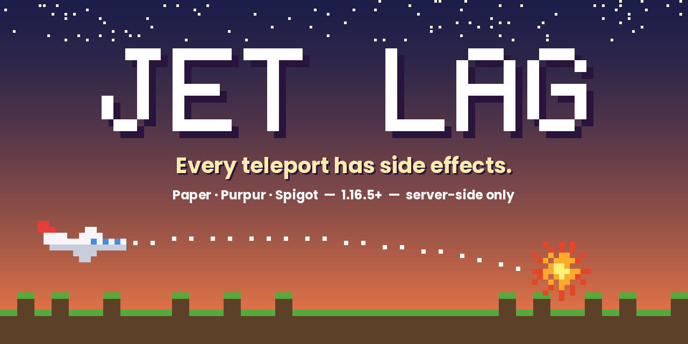
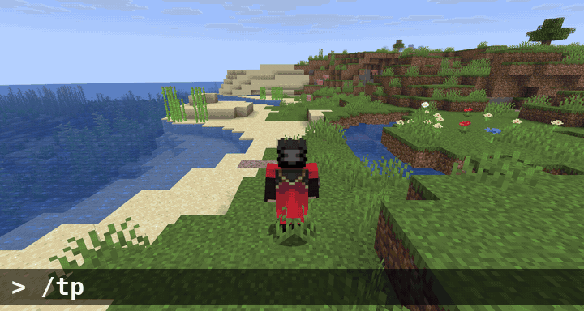
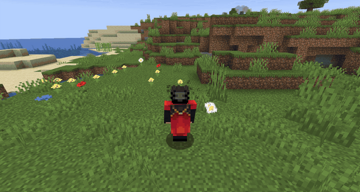
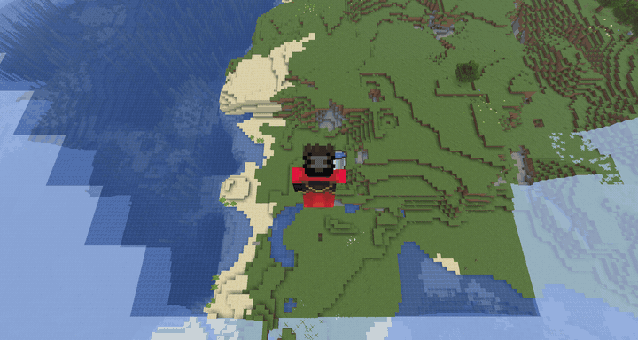
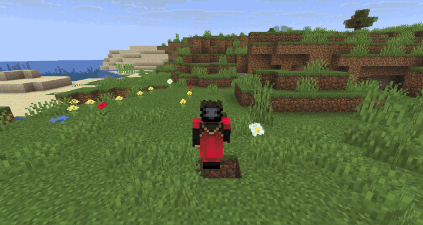
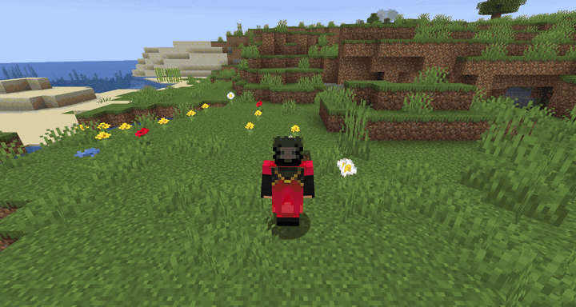
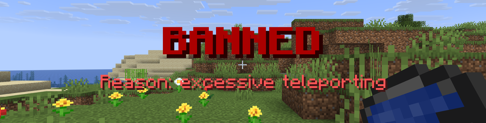
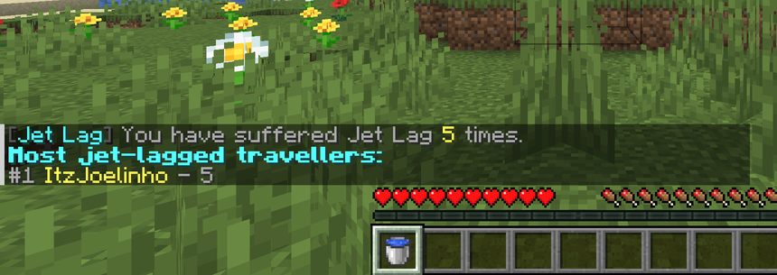

<p align="center"></p>

# ✈️ Jet Lag

**Every teleport has side effects.**



Jet Lag is a server-side plugin for Paper (and Spigot/Purpur) that turns every teleport into a gamble. Use `/tp`, `/tpa`, `/home`, `/spawn` or `/warp` and there's a chance something *happens* when you land: a charged creeper, a lightning bolt, a ring of TNT... or, very rarely, a first-class upgrade.

It's made for friend servers where chaos is the point. **Nobody needs to install anything on their client.**

## Features

- 🎲 **12 events**, each with its own weight and options
- 🧭 Works with **any teleport command**: vanilla `/tp` plus EssentialsX, CMI, etc. (`/tpa`, `/home`, `/spawn`, `/warp`...)
- 🧱 **No grief by default**: Jet Lag explosions hurt players, not your builds
- ⚙️ Configurable chance, cooldown, minimum distance, worlds and teleport types
- 📊 `/jetlag stats` leaderboard of the most jet-lagged players
- 🌍 English and Spanish included, easy to translate
- 🧩 One jar for **Minecraft 1.16.5 → latest**

## Events

| ID | What happens |
|---|---|
| `charged_creeper` | A fast, charged creeper spawns next to you |
| `lightning` | Lightning strikes you on arrival (no fire spread) |
| `tnt_ring` | 4 lit TNT appear in a 5-block ring around you |
| `anvil_rain` | Anvils fall from the sky (they vanish on landing) |
| `sky_drop` | You arrive 60 blocks too high, holding a water bucket. MLG! |
| `fake_creeper` | A creeper hisses behind you... and pops into fireworks |
| `fake_ban` | A scary "BANNED" title. Just kidding. |
| `chicken_party` | You land in the middle of a chicken party |
| `wrong_destination` | The GPS failed: you land next to a random other player |
| `hotbar_shuffle` | Your luggage got mixed up: hotbar shuffled |
| `drunk` | Nausea and slowness for a few seconds |
| `first_class` | Rare lucky outcome: free diamonds and fireworks |

### Gallery

| TNT Ring | Sky Drop |
|---|---|
|  |  |
| **Charged Creeper** | **Chicken Party** |
|  |  |
| **Fake Ban** | **Leaderboard** |
|  |  |

## Installation

1. Download `JetLag-x.y.z.jar` from Releases / Modrinth / Hangar.
2. Drop it into your server's `plugins/` folder.
3. Restart the server. Edit `plugins/JetLag/config.yml` and run `/jetlag reload`.

## Commands & permissions

| Command | Permission | Default |
|---|---|---|
| `/jetlag stats` | `jetlag.stats` | everyone |
| `/jetlag test <event> [player]` | `jetlag.admin` | op |
| `/jetlag chance [0-100]` | `jetlag.admin` | op |
| `/jetlag on` / `off` | `jetlag.admin` | op |
| `/jetlag reload` | `jetlag.admin` | op |
| — | `jetlag.bypass` (never get Jet Lag) | nobody |

Alias: `/jl`.

## Configuration (short version)

```yaml
chance: 15              # % of teleports that trigger an event
cooldown-seconds: 10
trigger-causes: [COMMAND]   # add ENDER_PEARL for extra chaos
block-damage: false     # true = Jet Lag explosions break blocks
events:
  tnt_ring:
    weight: 8           # 0 disables it
    count: 4
    radius: 5.0
```

The full file is commented: see [`config.yml`](src/main/resources/config.yml).

## Compatibility

- **Servers:** Paper, Purpur, Spigot. Folia is not supported.
- **Versions:** 1.16.5 and newer. The plugin is built against the 1.16.5 API and looks up anything Mojang has renamed (sounds, potion effects) by name at runtime.
- **Java:** whatever your server version needs (8+).

## Building

```bash
./gradlew build
# -> build/libs/JetLag-1.0.0.jar
```

## Support the project

If Jet Lag made your friends scream, consider supporting development:
[GitHub Sponsors](https://github.com/sponsors/JoelCardona01)

## License

[MIT](LICENSE). Use it, fork it, put it in your modpack.
